<!-- Header sóng động -->

<!-- Dòng chữ gõ tự động -->

  

  
  

 

## 👨‍💻 Giới thiệu

- 🎓 Tốt nghiệp tại **Trường Đại học Mở TP.HCM**
- 🔭 Đang làm việc với **Python (Django/Flask)**, **React Native**, **Java** và **Odoo**
- 📫 Liên hệ: **your.email@gmail.com**

 

## 🛠️ Tech Stack

  

 

## 🚀 Dự án nổi bật

<table>
  <tr>
    <td width="50%" valign="top">
      <h3>📁 <a href="https://github.com/quangphucqn/AlumniSocialNetWork">AlumniSocialNetWork</a></h3>
      
Backend mạng xã hội cựu sinh viên.

      

    </td>
    <td width="50%" valign="top">
      <h3>📁 <a href="https://github.com/quangphucqn/AlumniSNMobileApp">AlumniSNMobileApp</a></h3>
      
Ứng dụng di động cho mạng xã hội cựu sinh viên.

      
 

    </td>
  </tr>
  <tr>
    <td width="50%" valign="top">
      <h3>📁 <a href="https://github.com/quangphucqn/CourseMobileApp">CourseMobileApp</a></h3>
      
Ứng dụng di động quản lý khóa học.

      
 

    </td>
    <td width="50%" valign="top">
      <h3>📁 <a href="https://github.com/quangphucqn/Clinic-Management-System">Clinic-Management-System</a></h3>
      
Hệ thống quản lý phòng khám.

      

    </td>
  </tr>
</table>

 

<!--
## 🐍 Hoạt động đóng góp
Chỉ bỏ comment đoạn này SAU KHI workflow snake.yml đã chạy thành công.

  <picture>
    <source media="(prefers-color-scheme: dark)" srcset="https://raw.githubusercontent.com/quangphucqn/quangphucqn/output/github-snake-dark.svg" />
    <source media="(prefers-color-scheme: light)" srcset="https://raw.githubusercontent.com/quangphucqn/quangphucqn/output/github-snake.svg" />
    
  </picture>

 
-->

## 🤝 Kết nối

  
  
  

<!-- Footer sóng động -->

